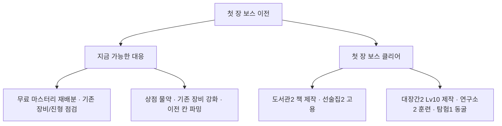

# 재미 관점 신규 진행 QA — 10분·60분·1일

**후속 검증에 따른 해석 보완 — 2026-10-30.** 아래의 최악 첫 보스 정체 세이브를 복제해 실제 대응을 비교했다. 무료 마스터리 재배분·장비 관리·안정적인 이전 장소 반복 파밍으로 **이 보고서의 원래 사본과 검증 종료 전 고정 사본 모두 약 33분에 돌파**했다. 기존의 “직전 칸 10전 파밍 뒤에도 못 깼다”는 짧은 실험으로 회복 수단의 부족을 판단할 수는 없다. 장기 무대응 정체와 해금 관문만으로 첫 보스 약화·기능 조기 해금의 필요성을 단정하지 않는다. 실제 신규 사용자의 이해도·재미는 여전히 별도 관찰 대상이다. [정상 대응 비교와 실제 화면 검증](../2026-10-30_first_boss_recovery/REPORT.md).

주 측정은 **2026-10-30 03:07 KST 작업 트리의 고정 사본 50개 조건**이다. QA 도중 작업 트리가 갱신되어 **03:38 KST 사본으로 대표 10개 조건을 하루까지 재검증**했다. 아래 50개 통계와 개입 실험은 첫 사본의 결과이며, 최신 결과는 별도 절에 구분했다. 계정 가입 화면이 없어 첫 출정부터 시간을 셌다. 이번 QA에서는 제품 코드·밸런스·사용자 저장소를 변경하지 않았다.

**핵심 판단**

초반 XP·골드와 장비 선택에는 성장감을 만들 재료가 있다. 스킬북·전직을 실제로 사용하면 전투가 달라지는 것도 확인했다. 우선 손볼 곳은 **첫 보스에서 막혔을 때의 회복 경로**, **보상·유료 선택지의 실제 효용**, **얻은 것과 다음 행동을 연결하는 안내**다.

자동 플레이 결과만으로 인간의 즐거움을 측정할 수는 없다. 이 보고서는 보상 간격·선택 가능성·선택 후 효과·정체와 실제 화면 조작을 근거로 재미의 위험을 판단한다. 재미 점수나 이탈률을 만들어 붙이지 않았다.

**검증 규모와 해석**

- 같은 시작 조건 20개를 두 정책으로 짝지어 비교하고, 무관리 10개를 더해 **50개 진행 조건·완료 원정 51,374회**를 실행했다. 조건마다 10분·60분·24시간을 저장했다.
- `basic`은 CSV 첫 노드 순서로 마스터리를 쓰는 약한 대리 정책이다. 수익·경험치 노드나 시전자에게 도움이 적은 평타 옵션을 먼저 찍을 수 있다. 게임에 자동 배분 기능이 있다는 뜻도, 일반 유저의 평균 행동이라는 뜻도 아니다.
- `adaptive`는 직업·무기에 맞춘 마스터리와 무료 재배분, 실제 재도전 안내에 따른 이전 칸 10전 파밍을 묶었다. **파밍만의 효과나 최적 빌드를 검증한 실험이 아니다.**
- 두 정책은 5분마다 실제 비용을 내고 장비·성장·건설·물약을 관리한다. 고용·스킬북·전직 등을 사용하지 않는 한계는 실제 UI 실험과 같은 세이브의 별도 개입 비교로 보완했다.
- 기본 배속 ×1 외에 ×2에서 선택한 3쌍을 10분·60분까지 다시 실행했다. 실제 90초 관전, 첫 선택, 약한/강한 체크포인트, 하루 복귀, 책·전직·훈련·합성의 실제 조작도 확인했다.

[정책·시간·지표의 상세 정의](simulation/METHOD.md), [전체 통계](simulation/summary.json), [인터랙티브 비교 차트](simulation/fun_charts.html).

**시점별 결과**

표의 레벨·드롭·장착 변경은 **03:07 사본의 기본 관리 20개 조건** 중앙값이다. 레벨은 파티 영웅 60명 기준이며 장착 변경은 파티 전체 변경 칸 수다. 장착 횟수가 곧 재미있는 의사결정 횟수라는 뜻은 아니다.

| 시점 | 수치와 직접 확인 | 재미 판단 |
|---|---|---|
| **10분** | Lv4, 장비 드롭 5개, 장착 변경 3칸. 첫 XP 중앙 13.1초, 첫 드롭 중앙 72.4초. 첫 드롭은 4.3초~6분 49.7초로 벌어지고, 20개 중 17개에서 매직 장비를 얻었다. | 성장 신호는 빠르다. 초반 손맛을 보상 간격만으로 비관할 근거는 없다. 첫 장비 경험의 편차와 첫 목표의 보상은 점검할 만하다. |
| **60분** | Lv11, 드롭 29개, 장착 변경 24.5칸. 두 관리 정책의 레벨 중앙은 같다. 직접 본 약한/강한 조건 모두 도안을 얻었지만 새 액티브를 배우지 않은 상태였다. | 장비·마스터리를 만지는 루프는 성립한다. 새 스킬·영웅 등 빌드 확장의 관문과 건설 예산 때문에, 얻은 도안이 당장의 선택으로 이어지지 않는 사례가 있다. |
| **계속 켜 둔 24시간** | 기본군 Lv40, 대응군 Lv48 중앙. 대응군이 같은 시드 20쌍 중 18쌍에서 더 진행하고 2쌍은 같았다. 무관리군은 Lv18 중앙이며 가방은 모두 찼다. | 준비와 운영이 장기 결과를 바꾼다. 동시에 새 칸에 진입하지 못하는 긴 구간이 있고, 미사용 성장 수단을 찾아 실행하는 부담도 커진다. |
| **60분 플레이 후 다음날 복귀** | 접속 중 하루와 다르다. 약한 시드 1은 레벨·골드가 그대로이고 재료만 늘었다. 준비한 다른 조건에는 연구 완료·동굴 장비·방문 영웅이 기다렸다. | 돌아올 보상은 있지만, 종료 준비 여부에 크게 좌우된다. 복귀 화면은 중단 통지보다 얻은 것과 다음 선택을 잘 설명할 필요가 있다. |

10분에는 대응 정책이 1쌍에서 앞서고 18쌍은 같고 1쌍은 뒤였다. 60분에는 8쌍에서 앞서고 3쌍은 같고 9쌍은 뒤였다. **준비·파밍은 당장의 전진과 장기 성장을 맞바꾸는 선택**이며, 대응 정책이 모든 시점에 더 빠르다는 결과는 아니다.

**좋았던 점 — 보상이 선택으로 이어질 때 전투가 실제로 달라진다**

- 실제 새 게임에서 15초 무렵부터 라운드 골드가 들어오고, 90초 관전에 Lv2·골드 871·8라운드 정산을 확인했다. 같은 후보·시드로 엔진을 독립 재구성했을 때 레벨·XP·골드·물약·장비 수가 정확히 일치했다.
- 처음 얻은 마스터리 포인트로 HP를 **105→115**로 올릴 수 있었다. 수치가 바로 보여 실험하기 좋다. 다른 선택의 행동 주기 **2.977→2.947초**는 약 1% 변화라 전투 체감에는 덜 드러났다.
- 장비 선택은 레벨 비교만으로 끝나지 않았다. 같은 방어력에서 **HP 재생 +0.4와 골드 +5%**를 고르는 사례를 실제로 확인했다. 이런 전투 안정성·수익의 교환은 게임의 장점이다.
- 하루 기본 시드 1의 같은 상태에서 책 세 권을 실제 제작·학습한 뒤 같은 구간을 10전 비교했다. 대조군 **8승·25.5분**, 책 학습 **8승·18.3분**, 책+마스터리 재배분 **10승·18.9분**이었다. 책만으로도 전투 양상이 바뀌었다. 비용은 **3,000골드+가루 30+약초 30+도안 세 장**이다. 짧은 한 조건의 비교이며 보편적인 승률·최적 조합은 아니다.
- 실제 UI의 다른 약한 하루 세이브에서도 파이어볼 학습 전후 같은 전투의 완료 라운드가 **2→5**, 파이어볼 시전이 12회로 바뀌었다. 강한 세이브의 메테오 전직 학습도 **4→5라운드**, 메테오 3회 시전으로 반영됐다. 두 사례 모두 전멸했으므로 클리어 성공으로 과장하지 않는다.

[첫 선택 UI](browser/first_choices.json), [직접 책 학습](browser/day_weak_book.json), [직접 전직](browser/day_strong_advance.json), [같은 상태의 개입 비교](interventions/state_basic_seed1_86400_ablate.json).

**우선순위 1 — 첫 보스의 무보상 재도전과 성장 수단의 공통 관문**

기본 시드 10은 첫 장 보스에서 **1,729번 연속 전투 보상 없이 패배**했다. 그 구간은 약 **16.3시간**이었다. XP·골드·장비가 없는 전투를 반복한 것이며, 연구소 재료까지 멈췄다는 뜻은 아니다. 다른 기본 시드 3에도 첫 보스 399회·약 4.8시간의 무보상 구간이 있었다.

이 최악 사례는 **수익/CSV 순서 편향 관리가 재도전 안내에 대응하지 않는 조건**이다. 일반 플레이어의 평균 시간으로 읽으면 안 된다. 대응군의 최대 전투 보상 공백은 약 **19.5분**으로 훨씬 짧았다. 다만 새 칸 첫 클리어가 없는 최장 구간의 중앙값은 기본군 **4.22시간**, 대응군 **3.90시간**이었다. 전진 정체와 보상 자체의 정체를 구분해야 한다.

첫 보스 이전에는 고용·도안으로 책 제작·동굴이 모두 다른 탈출구처럼 보이지만, 실제로는 그 보스 클리어가 건설 조건에 포함돼 있다. 최신 사본에서는 이미 가진 책의 학습은 도서관 1랭크+Lv10부터 가능하다. **학습과 도안의 책 제작은 다른 문턱**이며, 후자의 첫 보스 조건은 유지된다.

실제 첫 보스 정체 세이브를 복제한 단기 비교에서도 무료 직업 위주 재배분만으로 다음 10전을 바로 이기지는 못했다. 이전 일반 칸 10전은 약 한 시간 동안 레벨 **11/11/12→13/12/13**, 골드 약 **5천**을 회복시켰지만 곧바로 보스 10전 승리를 확인하지는 못했다. **준비 점검 알림이 뜬다는 사실과 해결 수단의 충분성은 별개다.** 이전에 간신히 깬 칸을 파밍 대상으로 잡으면 그곳에서도 자주 전멸할 수 있다.

×2도 확인했다. 선택한 여섯 조건에서 1시간 안에 첫 장을 마친 수가 ×1의 **2/6→×2의 5/6**으로 늘었다. 첫 시간의 답답함은 기본 배속에 민감하다. 첫 보스가 여러 시스템을 동시에 잠그는 구조는 그대로다. ×2로 하루 정체까지 해결된다고 주장할 근거는 없다.

검토 방향은 첫 보스의 무조건 약화보다 **확실한 파밍 구간으로 연결하는 동선**, **책 등 빌드 선택의 체험 시점**, **해금 목표와 필요한 준비의 가시성**이다. 수치 변경은 프로젝트의 PvP 기준을 함께 검증해야 한다.

[최악 조건 재현](simulation/critical_seed10/), [단기 대응 비교](interventions/state_basic_seed10_5520_ablate.json), [×2 비교](simulation/speed2_sensitivity/comparison.json), [해금 근거](analysis/first_boss_gate.md).

**우선순위 2 — 흥미로운 보상·유료 선택지의 일부가 실제 성장과 연결되지 않는다**

**미적용 발동 옵션.** 별도 원시 장비 관찰은 시드 1~3의 두 정책을 같은 조건으로 다시 실행했다. 추가 관찰을 빼면 메인 결과와 일치했다. 기본군 1,158개 중 **55개(4.75%)**, 대응군 2,296개 중 **144개(6.27%)**가 전투 미적용 옵션 또는 연결되지 않은 목걸이 발동을 포함했다. 첫 시간에도 자동 장착된 사례가 있었다. 그 장비의 모든 능력치가 무효라는 뜻은 아니다. 물리 적중 발동 중에는 정상 구현된 것도 있다. 문제는 시전 발동처럼 기대를 만드는 일부 보상 칸의 효과가 작동하지 않는다는 점이다. 실제 툴팁에도 미적용 표시가 있었다.

**사용처 없는 상위 재료 합성.** 실제 UI에서 철광석 **5개+20골드**를 내고 2단계 재료 한 개로 바꿀 수 있었다. 현재 제작·강화·물약·책·연구·건설은 기본 재료를 쓰며, 상위 결과물 **16종**은 추가 합성 외의 성장 소비처를 확인하지 못했다. 합성 뒤 Lv20 무기 제작도 기본 철광석을 요구했다. 값을 지불한 선택이 당장의 성장으로 돌아오지 않는다. 미완성 기능이라는 문서 상태와 실제 사용자가 누를 수 있는 유료 행동을 구분해 다뤄야 한다.

**구매에 비해 열등한 초기 물약 제작.** 같은 상태에서 동일한 물약을 직접 사고 만들어 비교했다. 회복 50/100/200 물약은 구매 시 **50/100/200골드**, 제작 시 각각 **500골드+약초 1/2/3개**였다. 결과 아이템은 같다. 상점에 접근할 수 있는 상태에서는 이 세 제작 경로에 비용을 더 지불할 이유를 확인하지 못했다. 상위 제작 전용 물약까지 같은 결론으로 확대하지 않는다.

이 세 항목은 새 시스템을 추가하기보다 **보상 효과의 실제 연결**, **소비처를 갖춘 재료 전환**, **같은 결과를 만드는 선택의 비용 차이**를 먼저 정리할 문제다.

[미적용 장비 원시 집계](analysis/inert_loot.json), [장비 관찰 일치 검증](simulation/loot_observer/main_parity.json), [합성·물약 실제 비용 대조](analysis/paid_choices.json), [합성 실제 화면 조작](browser/material_synthesis.json).

**우선순위 3 — 다음 목표와 선택 후 효과가 약하게 연결된다**

- 기본 시드 1의 1시간 상태에는 **Lv10 영웅, 파이어볼 도안, 골드 1,080·가루 40·약초 43**이 있어 책 제작 재료는 충분했다. 그러나 도서관 2와 첫 보스 관문 때문에 도안을 책으로 제작할 수 없었다. 최신 사본에서는 이 영웅의 학습 조건 자체는 열려 있지만, 가진 책 0권·도안 6종의 제작은 모두 `unbuilt`임을 실제 화면으로 재확인했다. 더 진행한 조건에서도 반복 유지비를 쓰고 건설비 3,000골드를 모으지 못해 제작이 잠겨 있었다. 전자는 해금, 후자는 지출 우선순위 문제다.
- 스킬북·고용·전직을 쓰지 않은 자동 정책의 하루 뒤에도 실제 선택지는 남아 있었다. 재화가 충분한 강한 세이브에 콘텐츠가 없다고 평가하면 잘못이다. 필요한 것은 그 선택을 발견하고 기대 효과를 판단하도록 연결하는 일이다.
- 약한 하루 세이브의 첫 의뢰는 고블린 궁수 12마리 중 1마리였고 부대는 5장에 있었다. 미션의 일반 문구와 원정 바로가기는 현재 5장으로 이동해 의뢰의 실제 대상 장소를 연결하지 않았다. 돌아가면 해결 가능한 목표이지만, 왜 지금 활동으로 진행되지 않는지 알아차리기 어렵다.
- 새 Lv1 영웅을 고용하고 훈련을 3시간 진행한 실제 조작에서는 **62/200 XP**, 여전히 Lv1이었다. 레벨 50 파티에 새 영웅을 넣는 보상에는 육성 계획이 필요하다. 훈련 속도만으로 신규 영웅 육성이 불가능하다고 판단하지는 않는다.

이 마지막 항목은 전투 육성으로 대조했다. 강한 하루 세이브에서 같은 후보를 실제 600골드에 고용하고, 기사 Lv49·궁수 Lv50이 보호하도록 편성한 뒤 시작 장비로만 싸웠다. 노말 1-1 I 5전은 **225.6초에 Lv5**, 노말 2-1 I 5전은 **181.8초에 Lv9**가 됐다. 두 분기 모두 5승이며 신규 영웅의 쓰러짐·받은 피해는 0이었다. **강한 파티가 있으면 새 영웅을 빠르게 키우기 시작하는 선택이 실제로 있다.** 만렙까지 따라잡는 시간이나 약한 초기 파티로 같은 보호가 가능한지는 이 실험으로 확정하지 않는다. 느린 훈련만을 근거로 고용 콘텐츠를 무용하다고 평가하면 안 된다.

라이브 재도전 안내 자체는 정상 동작했다. 실제 1시간/하루 상태에서 14회·19회 기록에 맞춰 준비 점검이 나타났다. 불러오면 진행 원정을 끊는 규칙 때문에 안내가 사라지는 상황을 라이브 안내의 고장으로 분류하지 않았다.

[라이브/복귀 안내 문맥](browser/guide_contexts.json), [브라우저 관찰 보고서](browser/REPORT.md), [훈련 조작 결과](browser/recruit_training.json), [동일 후보의 전투 육성 대조](analysis/recruit_carry.json).

**하루 복귀 — 종료 준비가 있을 때의 보상을 먼저 보여줄 필요가 있다**

기본 시드 1을 60분 후 종료하고 23시간 뒤 열면, 레벨 **10/9/8**과 골드 **1,080**은 그대로이고 재료는 철광석 **191·목재 190·약초 192**만큼 늘었다. 원정은 오프라인에 진행하지 않고 생산은 상한을 받는 현재 규칙의 정상 결과다. 복귀 첫 화면에는 원정 중단 알림이 크게 보이고, 얻은 재료와 다음 행동은 별도로 찾아야 했다.

같은 열 개의 1시간 세이브에서 실제 지갑·해금을 지키며 종료 준비를 비교했다. **9개에서 자원 연구를 시작할 수 있었고**, 이미 동굴이 열려 있던 **4개에서는 파티를 보낸 뒤 다음날 장비 3개씩을 실제 수령**했다. 한 조건은 진행 중인 수색 연구가 끝나 **영웅 2명**도 기다렸다. 약한 조건은 첫 보스 관문 때문에 동굴·훈련을 준비할 수 없었다.

이 루프에는 돌아올 이유가 존재한다. **지금 예약 가능한 일 안내 → 종료 전 준비 → 복귀 시 획득 요약 → 다음 선택**으로 묶는 것이 규칙을 바꾸지 않고도 검토할 수 있는 개선이다.

[동일 세이브의 준비/무준비 복귀 대조](analysis/daily_return_pairs.json), [실제 복귀 화면과 수치](browser/return_after_60m_day1.json).

**먼저 검증할 개선 실험**

| 순서 | 실험 | 볼 결과 |
|---|---|---|
| 1 | 첫 보스에서 막힌 신규 사용자가 안내만 보고 승률이 안정적인 이전 칸을 찾아 돌아올 수 있는지 관찰 | 첫 재도전 안내부터 실제 대응까지 걸리는 시간, 연속 무보상 전투 수, 대응 후 새 선택 |
| 2 | 첫 추가 액티브의 체험 시점·도서관 목표 표시를 바꾼 비교안 | 스킬 획득→사용까지의 시간, 비용 이해, 전투 변화 인식. 즉시 모든 해금을 풀 필요는 없음 |
| 3 | 미적용 발동 옵션과 용도 없는 유료 합성의 노출/연결을 정리한 비교안 | 획득 후 사용 이유를 설명할 수 있는 비율, 되돌리고 싶은 소비, 실제 전투/성장 효과 |
| 4 | 복귀 보상 요약과 현재 가능한 종료 준비 안내 | 복귀 직후 보상을 알아차리는지, 예약 행동을 고를 수 있는지, 다음 목표까지의 조작 |
| 5 | 의뢰 바로가기를 실제 대상 정보·해금된 장소와 연결 | 현재 활동으로 안 차는 이유 이해, 목표 장소 도달 시간, 첫 의뢰의 장기 방치 감소 |

위 표는 이번 QA의 제안이며 제품에 적용한 변경이 아니다. 관찰한 인간의 이탈률·재미 만족도는 없으므로, 효과 수치는 후속 실제 사용자 관찰에서 검증해야 한다.

**최신 03:38 사본 재검증 — 핵심 문제는 유지, 하루의 세부 수치는 달라짐**

주 측정 이후 물리 발동 처리, 도서관 학습 해금, 명성 상승 시 미수락 의뢰 갱신, 문구·UI 등이 바뀌었다. 동일한 시뮬레이터로 시드 1·2·3·4·10을 두 정책으로 짝지어 **10개 조건·원정 11,005회**를 다시 실행했다. 좋은 사례와 정체 사례를 함께 고른 표본이며 새로운 전체 분포 추정은 아니다.

| 최신 5개씩의 중앙값 | 기본 10분 / 60분 / 1일 | 대응 10분 / 60분 / 1일 |
|---|---|---|
| 영웅 레벨 | 4 / 9 / 39 | 4 / 11 / 49 |
| 장비 드롭 수 | 3 / 30 / 412 | 5 / 35 / 881 |
| 장착 변경 칸 수 | 1 / 22 / 111 | 1 / 28 / 267 |

- 같은 계정의 핵심 지표는 이전 사본과 10분에 9/10, 60분에 7/10, 하루에 1/10만 같았다. **앞의 50개 조건 하루 통계를 최신 버전의 정확한 수치로 쓰면 안 된다.**
- 기본 시드 10의 첫 보스 장기 정체는 그대로 재현됐다. 하루 지표와 약 **16.36시간의 전투 보상 공백**도 동일했다. 기본 시드 3의 연속 무보상 구간은 최신 사본에서 약 **8.80시간**으로 길어졌다. 약한 정책의 위험 사례이며 사람의 평균 행동을 뜻하지 않는다.
- 최신 다섯 쌍 모두 대응 정책이 하루 뒤 더 많은 칸을 클리어했다. 기본 대비 추가 클리어 칸은 시드 순서로 **26·10·30·4·66개**다. 정책 묶음의 효과이며 파밍 한 행동만의 인과 효과는 아니다.
- 책 학습은 **도서관1+Lv10**, 도안의 책 제작은 **첫 보스+도서관2+건설비 3,000골드**로 구분했다. 시전·피격 발동의 미적용, 상위 재료의 합성 외 소비처 부재, 다음날 원정 중단·레벨/골드 유지도 최신 코드와 실제 화면에서 재확인했다.
- 최신 전체 회귀 **732/732**, 상태 교차 검사 **91/91**, 원본 비계측 엔진과 첫 원정 **10/10 일치**, 동일 시드의 하루 재실행 일치를 확인했다. 사본 변경·실행 오류는 없었다.

[최신 버전별 비교](current_validation/simulation/version_comparison.json), [재실행 기록](current_validation/simulation/run_info.json), [최신 측정 검증](current_validation/simulation/validation.json), [최신 실제 화면·회귀 부록](current_validation/browser/REPORT.md), [사본 사이 변경 감사](current_validation/changes_from_primary.json), [최신 기준 해시](current_validation/source_manifest.json).

**측정의 신뢰성과 한계**

- 계측 시간 예산·물약 수량·아이템·실패 라운드 보상·승급 조건 등의 **2,012개 교차 검증 통과**. 원본 비계측 엔진과 첫 원정 10시드의 리포트가 **10/10 동일**했다. 같은 시드 재실행과 추가 장비 관찰도 원 결과와 일치했다.
- 실제 90초 조작의 후보·시드·기록 재생 시각으로 엔진을 재구성해 레벨·XP·골드·재고가 일치했다. 임의의 속도 환산 배수로 보상을 추정하지 않았다.
- 첫 03:07 사본의 기본 단정은 **729/730 통과**였다. 실패 한 건은 해당 사본의 `balance.csv`·`weapon_sin_option.csv` 입력과 기존 `golden.json`의 전투 지문이 다른 검사다. 60런 중 40런이 달랐다. 이번 QA에서 골든 파일을 갱신하지 않았다. **03:38 사본의 회귀는 별도로 732/732 통과**했으며 앞 사본의 실패를 소급해 지우지 않았다.
- 계속 켜 둔 하루는 기본 배속의 가상 경과 시간이다. 실제 기기를 24시간 켠 내구 시험이 아니다. 읽기·클릭 시간은 시뮬레이션에 임의로 붙이지 않았고 실제 UI 조작과 구분했다.
- 무관리 정책은 일부러 아무 성장 행동도 하지 않는 극단 대조군이다. 기본/대응 정책도 재화 유보·책·고용·전직 등을 충분히 활용하는 사람을 대신하지 않는다. 작은 개입 예제는 가능한 효과를 보여주지만 일반 승률·최적 빌드·시장 이탈률을 추정하지 않는다.
- 그림은 원래 자산을 읽고 코드·CSV·스타일은 고정했다. UI가 import하는 얼굴 레지스트리는 별도 해시로 보존했다. 사용자 서버·저장소·운영 Firebase에는 쓰지 않았다.

[측정 검증](simulation/validation.json), [원본 엔진 대조](simulation/engine_observation_parity.json), [네이티브 UI 재구성 대조](interventions/onboarding_native.json), [기존 단정 결과](browser/baseline_assertions.json), [코드/데이터 기준 해시](source_manifest.json), [얼굴 레지스트리 해시](asset_module_manifest.json).

추가 분석과 재현 코드: [시뮬레이션](simulation/), [실제 화면·조작](browser/REPORT.md), [경제·해금·미완성 효과 분석](analysis/FINDINGS.md), [독립 개입 비교](interventions/).
