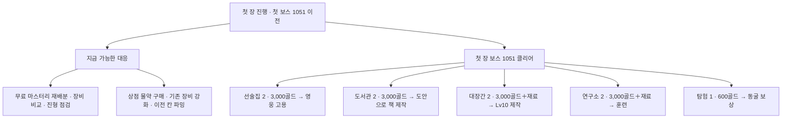

기준: 03:07 KST 사본. 최신 03:38 사본에서는 가진 책의 학습이 도서관1+Lv10으로 앞당겨졌지만, 아래 **도안으로 책 제작**의 첫 보스·도서관2 조건은 유지된다. [최신 실제 화면 검증](../current_validation/browser/REPORT.md).

해금과 구매는 별도다. 보스를 깼어도 각 건설비·재료와 고용비·책 제작비가 추가로 든다. 이 그림은 자동 파밍·무료 성장·새 전투 규칙을 제안하지 않는다.
