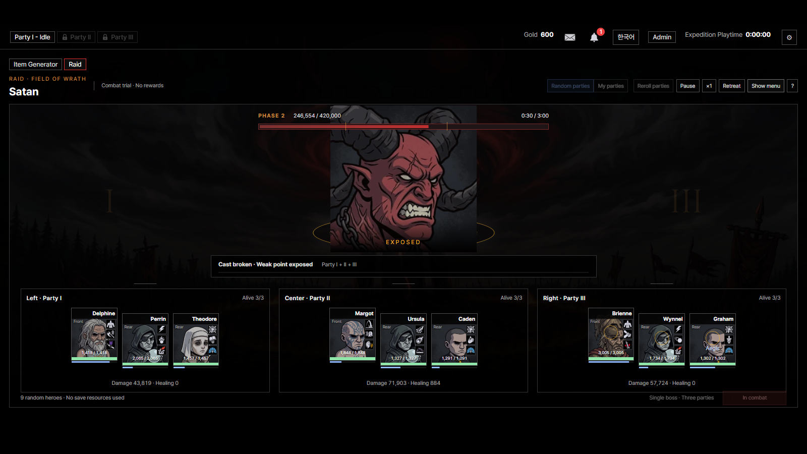
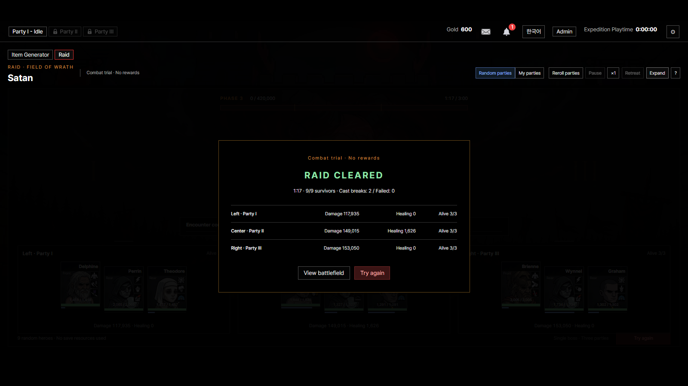

# 세 편성 레이드 구현 및 검증

2026-10-30 · 전투 연습 시제품

[바로 체험](http://localhost:8799/index.html?dev=raid&lang=ko) · [설계 초안](../../docs/game_design/raid_draft.md) · [검증 결과](verification.json) · [전체 회귀](regression.json)

렉 원인과 전후 측정은 [성능 수정 보고서](performance/REPORT.md)에 정리했습니다. 게이지·피해 숫자·중복 피격과 리스너·시계 렌더를 고쳤고 이펙트를 켠 저속 CPU 시험에서 레이아웃 계산 시간이 약 71% 줄었습니다.

현재 위치는 **실험실 → 아이템 생성기 오른쪽의 레이드 탭**입니다. 독립 레이드 메뉴는 제거했습니다. 도구 탭과 다른 화면을 오가면 선택과 진행 중인 판을 유지하고, 레이드를 보지 않는 동안에는 연습 시계를 멈춥니다.

## 구현

- 전방의 큰 사탄과 공동 HP, 하단 좌익·중앙·우익의 세 편성. 전열과 후열, 영웅 HP·행동 게이지·기존 스킬 연출.
- 한 편성 강타·인접 두 편성 휩쓸기·전면 광역·파괴 가능한 강공격. 공격 대상과 남은 시간 예고.
- 방어·집중 공격·다른 편성 지원. 편성별 공유 재사용 시간과 자동 지휘.
- 강공격 파괴 → 약점 노출, HP에 따른 단계 변화, 전멸과 제한 시간 판정.
- 훈련 영웅 아홉 명으로 즉시 체험. 내 편성은 헬 챕터보스 처치·서로 다른 영웅·원정/탐험 점유 검사.
- 확대·배속·정지·철수·결과·재도전, 탭 이동과 문서 숨김 시 정지, 한영 UI와 도움말.

공용 전투 엔진과 피해·스킬 공식을 재사용합니다. 회복·강화·오오라·소환물은 자기 편성 범위이며 보스의 약화는 공동으로 작동합니다. 내 편성의 전술과 실제 전투 능력치를 스냅샷으로 사용합니다. 보스의 종족·등급에 따른 기존 장비 효과도 적용합니다.

## 검증

| 검사 | 결과 |
|---|---|
| 전체 게임 회귀 검사 | **PASS 788/788** |
| 레이드 전투 불변식 | **26/26** — 전체 검사에 포함 |
| 브라우저 흐름 | **26/26** — 실험실 배치·도구 왕복·기존 링크·시계 렌더·이펙트 정리 포함 |
| 브라우저 예외 / 누락 아트 | **0 / 0** |

전투 검사는 결정론·실행 구간 분할·원본 불변·파티 효과 범위·종족별 보정·표적 고정·명령 쿨·지원·파괴 성공과 실패·부분 전멸·시간 초과·철수·내 편성 해금과 점유를 포함합니다. 화면 검사는 실제 시작부터 정지·이탈/복귀·문서 숨김·언어 전환·확대·종료·재도전·철수·도움말까지 실행합니다.

## 조율 결과

고정 훈련 편성에 전투 시드 1~20을 적용한 결과입니다. 평균 시간과 생존자는 패배한 판도 포함합니다.

| 명령 | 승리 | 평균 전투 시간 | 평균 생존자 |
|---|---:|---:|---:|
| 자동 지휘 | 19/20 | 95.45초 | 8.00/9 |
| 명령 없이 자동 전투 | 16/20 | 109.85초 | 6.35/9 |

위 표는 전투 엔진 구현 당시의 조율 결과입니다. 현재 수치는 훈련 편성 기준의 제안이며 다양한 실제 영웅 조합 전체의 밸런스를 확정한 값은 아닙니다.

## 파일

| 영역 | 파일 |
|---|---|
| 전투 조율 | `src/game_logic/raid.js` |
| 전장 | `src/ui/raid.js`, `src/ui/raid.css` |
| 실험 수치 | `src/data/raid_boss.csv`, `src/data/raid_pattern.csv` |
| 전투 검사 | `src/dev/raid_test.js` — `src/dev/test.js`에 통합 |
| 브라우저 검사 | `scripts/verify_raid.py` |

재현: `python serve.py 8799` 실행 후 `python scripts/verify_raid.py --raid --calibrate`, 전체 검사는 `python scripts/verify_raid.py`입니다.

## 남은 기획

정식 보상·유니크/도안 연결·반복·입장 비용·전투 저장과 복구·다른 보스·추가 몬스터는 아직 정하지 않았습니다. 이번 버전은 **보상 없는 연습**이며 물약을 쓰지 않고 영웅·장비·재고·진행을 소모하지 않습니다. 연습 판은 새로고침하면 초기화됩니다.

## 화면

