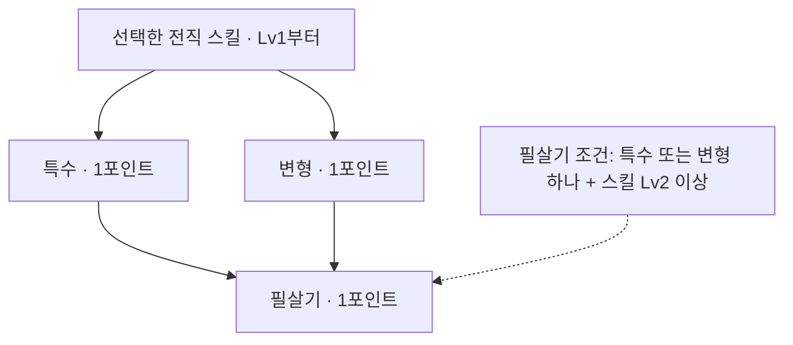

# 전직 스킬 구조·밸런스 검토와 꼬리 트리 논의안

> **2026-11-01 정정:** 이 검토의 ‘전직 전용 5포인트’ 해석은 잘못됐다. 실제 규칙은 레벨마다 받는 기존 스킬 포인트를 마스터리·전직 메인·꼬리가 공유하고, 메인 단계만 5레벨 간격으로 해금하는 것이다. 해당 예산에 의존한 배분·선행 제안은 재검토 대상이다. 공격 기능 실험 결과와 구분한다.

검토일: 2026-10-31. 현재 작업 폴더의 CSV·전투 코드 기준. **기획 확정이나 게임 수정이 아닌 검토·논의 자료**다.

## 결론

5직업 × 3전직 × 3후보 중 하나를 배우는 큰 구조는 유지할 만하다. 다만 현재 구현은 여러 고유 기능을 일반 공격·버프로 대신하고 있어, 지금 수치만 조절해서 45개 선택지를 균형 있게 만들기는 어렵다. **각 뿌리의 기본 기능 복원 → 같은 역할의 선택지 비교 → 꼬리의 포인트 가치 비교** 순서가 맞다.

전직 하나에서 셋을 함께 쓰는 구조가 아니다. 각 스킬은 **혼자 골라도 역할을 완성**해야 한다. 리저렉션은 이지스와 같이 고르는 안전장치가 아니며, 몽크의 반격도 금강을 동시에 고를 수 없다.

## 확인한 현재 구조

- `src/data/advance.csv`: 15갈래.
- `src/data/skill.csv`: 전직 45개. 전직은 Lv30·50,000골드. 갈래는 현재 되돌릴 수 없고, 같은 갈래의 스킬과 투자 포인트는 무료 반환 가능.
- `src/data/advance_node.csv`: 135칸. 설명이 있는 칸 118, 보류 칸 17. 현재 가지는 배울 수 없으며 효과를 전투에 적용하지 않는다.
- Lv30·35·40·45·50에 전직 포인트 1씩, 총 5. 첫 포인트도 학습에 쓴다. 따라서 **스킬 Lv2 + 꼬리 3개 = 5포인트**, **스킬 Lv5 = 5포인트**다.
- `docs/game_design/skill_design.md`의 특수·변형·필살기 틀은 존재하지만 가지 사이 선행은 미확정이다.

## 우선 해결할 실제 문제

1. **기본 정체성이 임시 구현으로 빠져 있다.** 라그나로크는 스킬 봉인·공속·방어 없이 공격력만 올린다. 버서크·동귀어진은 HP를 소모하지 않는다. 재장전은 처치 시 쿨 초기화 대신 공속 버프다. 리저렉션은 부활 대신 살아 있는 아군 하나를 회복한다. 사냥 표식은 받는 피해 증가 대신 적이 주는 피해를 감소시킨다. 속죄는 회복 연결 없이 적 피해 감소만 건다. 파문은 버프를 벗기지 않는다.
2. **현재 효과를 기준으로 우위가 분명한 쌍이 있다.** 성전과 불굴의 맹세는 모두 파티 최대 HP 30% 보호막인데 성전은 22초 쿨·12초 지속, 맹세는 24초 쿨·8초 지속이다. 호령과 지원 사격은 모두 파티 공격력 버프·18초 쿨·10초 지속인데 각각 +30%, +20%다. 이는 원안의 우열이 아니라 임시 구현끼리의 우열이다.
3. **포인트를 써도 성장하지 않는 구간이 있다.** 정전장은 레벨 증가 필드가 없어 Lv1과 Lv5 효과가 같다. 히드라는 타수 +0.3을 버림 처리하므로 Lv1~5 타수가 `3 / 3 / 3 / 3 / 4`다. 정전장에도 포인트를 넣을 수 있다.
4. **고정 주기와 공속 투자가 충돌한다.** 퀵 드로우는 무기 주기의 50%·평타 피해 60%, 오버드로우는 140%·평타 피해 170%다. 원래 무기 주기 기준으로는 창 동안 약 1.20배·1.214배지만, 민첩·장비·마스터리로 이미 빨라진 실제 평타와 비교하면 손해일 수 있다. 고정 주기가 스킬 사용 기회도 바꾼다.
5. **물리와 캐스터의 행동 비용이 달라졌다.** 현재 보통 물리 스킬은 사용 뒤 평타도 친다. 마법 무기는 평타가 없고 충전된 시전 기회를 사용한다. 정신 집중은 집중 시간도 비용이다. 기존 `(배율−1) / ceil(쿨/1.5)` 검사와 20% 예산만으로는 현재 밸런스를 입증할 수 없다. 검사에는 광역·버프·사제 고정 피해·여러 트리거의 비용도 충분히 반영되지 않는다.
6. **보호막이 서로 덮어쓴다.** 현재 `barrier_pct` 핸들러는 대상의 단일 `barrier` 풀을 새 값으로 교체한다. 45% 이지스 뒤 30% 성전이 걸리면 흡수량이 작아질 수 있다. 보호막 꼬리를 설계하기 전에 공존·우선순위 규칙이 필요하다.
7. **원정 도중 같은 스킬의 레벨만 올리면 즉시 반영되지 않을 수 있다.** 갈아입기 서명이 액티브의 출처·ID만 세고 `up`을 제외한다. 기존 DEV_PLAN 부채 #85와 일치한다. 레벨을 올린 직후 실전 비교를 할 때 새 런을 사용해야 한다.

변신·현재 HP 비용·반사·HP 최대 대상·전열 대상 등의 기반 장치는 이후 기본·보스 스킬용으로 생겼다. CSV의 예전 “장치가 없다” 메모를 현재 엔진 능력으로 해석하면 안 된다. 다만 기반 장치가 있다는 것과 해당 전직 원안이 전부 구현됐다는 것은 별개다.

## 15갈래별 판단

| 전직 | 형태 판단 | 가장 먼저 볼 부분 |
|---|---|---|
| 광전사 | 평타 변신 / HP를 태우는 스킬 강화 / 목숨 건 한 방은 잘 갈린다 | 세 스킬의 대가를 기본 효과에서 구현해야 한다. HP 비용이 현재 HP인지 최대 HP인지, 자해로 죽는지, 한 전투의 누적 부담을 정한다. |
| 바바리안 | 다단 / 큰 적 강타 / 광역 제어의 구분은 유지할 만하다 | 휠윈드는 현재 총 5타를 전열에 나누므로 적 수만큼 총 피해가 증가하지 않는다. 토르의 분노는 HP 최대가 아닌 방어 최대를 겨냥한다. |
| 선봉장 | 공격·속도 지원 / 아군 화력 / 적 화력 감소가 명확하다 | 파티 전체의 기여로 비교한다. 호령 꼬리에 치명·흡혈까지 모두 얹으면 범용 정답이 될 위험이 크다. |
| 가디언 | 피해 전가 / 피격 누적 방어 / 반사는 구분이 좋다 | 현재는 파티 감소 / 자기 감소 / 자기 보호막이다. 전가 피해가 반사·피격 스택을 다시 부르는지 정의해야 한다. |
| 팔라딘 | 치명타 방지 / 보호막 잔량 폭발 / 최대 HP 증가는 잘 갈린다 | 맹세와 성전의 기본 차이를 복원한다. 성전이 자기 보호막만 폭발 재료로 쓰도록 소유권을 정한다. |
| 크루세이더 | 아군 피격 축적 / 처형 / 한 대상 결전은 유지할 만하다 | 응징·결전의 단순 자기 공격력 버프 중복을 해소한다. 결전에는 실제로 다른 적에 대한 손해가 있어야 한다. |
| 파이어 메이지 | 순간 폭딜 / 지속 장판 / 자동 타격은 좋다 | 현재 셋 모두 즉시 공격이다. 장판의 다음 라운드 이월, 히드라의 자동 타격·중복 설치·저항 감소 상한을 정한다. |
| 프로스트 메이지 | 중심 강타 / 지속 지원 / 단일 축적 폭발은 좋다 | 빙결·스턴의 기본 스킬과의 중복, 보스 제어 효율, 버스트가 자기 스택으로 혼자 완결되는지 확인한다. |
| 썬더 메이지 | 연쇄 확률 폭딜 / 잦은 광역은 구분된다 | 정전장 기본 효과부터 결정해야 한다. 현재 HP 비율 피해를 채택한다면 보스 배율·체력 하한·공격력 기준 상한이 필요하다. |
| 스나이퍼 | 스킬 증폭 / 큰 한 발 / 처치 연쇄는 좋다 | 정조준과 재장전이 현재 일반 버프로 축소돼 있다. 일격의 조준 꼬리는 기존 기본 스나이프가 이미 2초 모으기라는 점과 함께 다시 본다. |
| 보우마스터 | 적중 횟수 / 무거운 한 발 / 다수 관통은 좋다 | 퀵·오버의 공속 투자 손실을 먼저 해결한다. 고정 주기 유지와 현재 주기 비율 변경 중 후자를 권장하되 이는 기존 확정 변경을 필요로 하는 제안이다. |
| 레인저 | 표식 / 아군 평타를 따르는 사격 / 매복은 좋다 | 현재 표식·지원 사격·덫 모두 핵심 작동이 다르다. 지원 사격은 레인저 공격력·발동 빈도·발동 대상 제한으로 조절해야 한다. |
| 비숍 | 맞기 전 / 맞은 뒤 / 쓰러진 뒤가 매우 명확하다 | 이지스는 현재 단일 아닌 파티 보호막, 베네딕션은 잃은 HP 비례 아닌 일반 힐, 리저렉션은 부활이 아니다. 살아 있는 아군 대상 규칙으로 부활 꼬리를 만들 수 없다. |
| 검은사제 | 약화 활용 / 피해를 회복으로 / 강화 해제는 좋다 | 현재 천벌은 조건 없는 광역, 속죄는 피해 감소, 파문은 해제 없는 단일 공격이다. 조건이 없는 상태의 배율을 완성판 값으로 쓰면 안 된다. |
| 몽크 | 전열에서 버티기 / 전열 소탕 / 반격의 구분은 좋다 | 사제의 체력·무기·능력치가 자동으로 전열형이 되지 않는다. 금강을 고르지 않은 소탕·반격도 전열에서 기능할 생존 경로가 필요하다. 원안 물리 반격과 사제 공격 고정 피해 규칙도 재확인이 필요하다. |

## 통제 전투 실험

`run_review.py` → Edge 헤드리스 → 실제 `buildSystems`·`battle.createRun`을 사용했다. 총 **4,016회**, 각 120초다. 45스킬에 대해 Lv30/Lv50, 스킬 Lv1/Lv5, 적 1/3명, 시드 12개의 공격 비교를 수행하고 궁수의 공속·무기 비교를 추가했다.

공통 조건은 능력치 전부 20, 일반 무기·갑옷, 마스터리·랜덤 옵션·물약 없음이다. 검토 영웅 외 동료는 도끼 전사·석궁 궁수다. 적은 매우 높은 HP·방어와 원소 저항 0이며 행동하지 않는다. 이는 **공격 기능과 투자 효과를 분리하는 실험이며, 캠페인 승률·회복·탱킹·부활 밸런스 검증은 아니다.** 시드 12개 평균에는 RNG 오차가 남으므로 작은 차이로 우열을 판정하지 않았다.

아래는 별도 무기 피해 굴림 고정·치명 없음·명중 보정을 사용한 **평타만 장착한 영웅의 자기 DPS** 비교다. “추가 공속”은 `speed_pct`에 더한 퍼센트포인트이며 주기 계산에 반영했다. 무작위 치명·명중 차이를 제거한 수치다. 수치는 120초 전체 평균이다.

| 활, 단일 적 | 추가 공속 없음 | 추가 공속 +100%p |
|---|---:|---:|
| 퀵 드로우 | −13.3% | −29.2% |
| 오버드로우 | −0.6% | −35.4% |
| 체인 드로우 | −14.8% | −14.8% |

체인 드로우의 단일 손해는 평타가 전원에게 75%로 바뀌는 명시적인 광역 교환이다. 퀵 드로우의 적중 부가 효과는 이 실험에 없으므로 전체 빌드가 항상 약하다고 단정할 수 없다. 오버드로우는 고공속 단일 빌드에서도 큰 손해를 보므로 단순 “느리지만 강하다” 설명만으로는 투자 가치를 보장하지 못한다. 실제 몬스터 처치 속도·초과 피해·기본 스킬 2칸·적중 발동 장비를 포함한 후속 비교가 필요하다.

원자료·스킬 Lv1/Lv5 해석값·소스 해시는 `results.json`에 있다. 45개 각각의 현재 효과와 기존 꼬리 설명은 [SKILL_INVENTORY.md](SKILL_INVENTORY.md)에 정리했다. 재실행: `python output/2026-10-31_advance_review/run_review.py`.

## 꼬리 트리 제안 — 아직 미확정

45개 × 3꼬리라는 제작 규모를 유지한다. **전직 갈래의 성격은 기본 스킬에서 완성하고, 꼬리는 그 스킬을 사용하는 이유를 달리하게 한다.** 부활·표식·반격이라는 핵심 동작 자체를 꼬리에 미루면 뿌리가 임시 기능으로 굳는다.

각 꼬리는 다음 역할을 권한다.

- **특수:** 스킬 고유의 문제를 보완한다. 예: 메테오 화상, 이지스가 지키는 대상의 경직 방지. 단순 피해 +%를 반복하지 않는다.
- **변형:** 유리한 전투 상황을 바꾼다. 예: 한 대상 보호막을 전열에 총량 분배, 단일 표식을 약한 전체 표식으로 교환. 범위·빈도·단일 효율 중 무엇을 내주는지 표시한다.
- **필살기:** 고유 동작을 확장해 완성한다. 예: 메테오 유성우, 파문으로 벗긴 버프 일부를 아군에게 전달. 별도 액티브 칸이 늘어나는 방식은 피하고, 발동 횟수·이벤트 재발동·총량을 제한한다.

선행은 **특수·변형을 독립 선택**하고, **필살기는 스킬 Lv2 이상 + 앞의 꼬리 중 하나**를 요구하는 안을 권한다. 지금 UI의 직렬 세 칸을 그대로 선행 규칙으로 확정할 필요는 없다.

총 5포인트에서 Lv5, Lv4+특수, Lv4+변형, Lv3+특수+변형, Lv3+특수+필살기, Lv3+변형+필살기, Lv2+세 꼬리를 비교할 수 있다. 이는 **기존 포인트 양을 유지하는 제안**이다.

“필살기”라는 이름이 무조건 우월한 선택을 뜻하면 전원이 Lv2+세 꼬리로 굳는다. 스킬 레벨의 실제 최종 기여와 꼬리의 기여를 같은 1포인트 값으로 비교해야 한다. 특히 쿨 감소·지속 시간·타수·보호막량이 각각 다른 성장 곡선을 가지므로 일률적인 “10%씩”으로 맞출 수 없다.

### 논의를 시작할 대표 스킬

| 스킬 | 기본에서 완성할 것 | 특수 후보 | 변형 후보 | 필살기 후보 |
|---|---|---|---|---|
| 메테오 | 강한 한 번의 운석·확정된 대상 규칙 | 화상 | 즉발 피해 일부를 잔불로 배분 | 단일 운석을 약한 복수 운석으로 교환한 유성우 |
| 휠윈드 | 무기로 전열을 여러 번 공격 | 경직 강화 | 타수 증가와 1타 피해 감소 교환 | 방어 감소를 일정 상한까지 누적 |
| 성전 | 파티 보호막·자기 보호막 잔량의 폭발 | 제한된 보호막 재충전 | 만료 폭발을 파괴 시 작은 폭발로 교환 | 흡수한 피해 일부도 폭발 재료로, 공격력 또는 보호막 기준 상한 적용 |
| 오버드로우 | 느린 대신 평타 한 발이 센 교환, 공속 투자와의 관계 정리 | 큰 적 상대 추가 효과 | HP 최대 대상 우선 또는 약한 관통으로 역할 교환 | 과잉 피해 일부 이월 등 한 발의 낭비를 줄이는 완성 — 정체성부터 논의 |
| 리저렉션 | 실제로 쓰러진 아군 1명 복귀·런당 횟수 제한 | 부활 대상의 쿨 초기화 | 낮은 HP로 여러 명 복귀·추가 비용 검토 | 복귀 직후 제한된 보호나 공격 기회 제공 — 상시 공격 증가와 비교 |

기존에 확정된 꼬리와 다른 부분은 **재검토 제안**이다. 전부 새로 확정한 표가 아니다. 우선 메테오(직접 공격), 성전(보호), 오버드로우(맞바꿈)의 3개로 포인트 구조를 검증한 뒤 나머지에 확장하는 편이 판단하기 쉽다.

## 공통으로 정해야 할 밸런스 규칙

1. **동일 포인트 비교:** Lv5 대 Lv2+세 꼬리뿐 아니라 중간 배분을 함께 비교한다. 필살기가 없는 빌드도 특정 전투에서 경쟁해야 한다.
2. **단일·다수·짧은 라운드·긴 보스전을 분리:** 1/3/6대상, 10/30/120초. 원정 라운드 이월을 사용하는 장판은 단판 실험과 별도다.
3. **지원은 파티 전체로 비교:** 공격 버프는 다른 피해 %와 더해져 장비가 좋을수록 상대 효율이 달라진다. 속죄는 회복 분배·유효 회복·파티 DPS와의 배가를 함께 본다.
4. **트리거 단위:** 타격당·대상당·시전당을 명시한다. 지원 화살·반격·에코·장비 발동이 서로 다시 발동하지 않도록 출처 규칙을 정한다.
5. **상한:** HP 비율 피해·저항 감소·처치 시 쿨 초기화·지속 연장·반사 축적·부활 횟수는 각각 상한이 필요하다. 단순 숫자 조절로 무한 증가 구조를 해결하지 않는다.
6. **보호막과 전가 소유권:** 어느 스킬의 보호막을 누가 흡수·회복·폭발 재료로 쓰는지 정한다. 전가된 피해가 다시 전가·반사·응징 스택을 부르는지도 고정한다.
7. **제어의 가치:** 기본 딥 프리즈의 스턴과 전직 스턴을 구분하고, 보스에게 적용할 효율·지속 제한을 정한다. 상태이상을 주는 기본 스킬과 똑같은 꼬리를 단순히 늘리지 않는다.

게임 코드와 정식 기획서는 변경하지 않았다. 방어·회복·부활의 실전 승률과 최종 배율은 이번 공격 통제 실험으로 확정하지 않는다.
